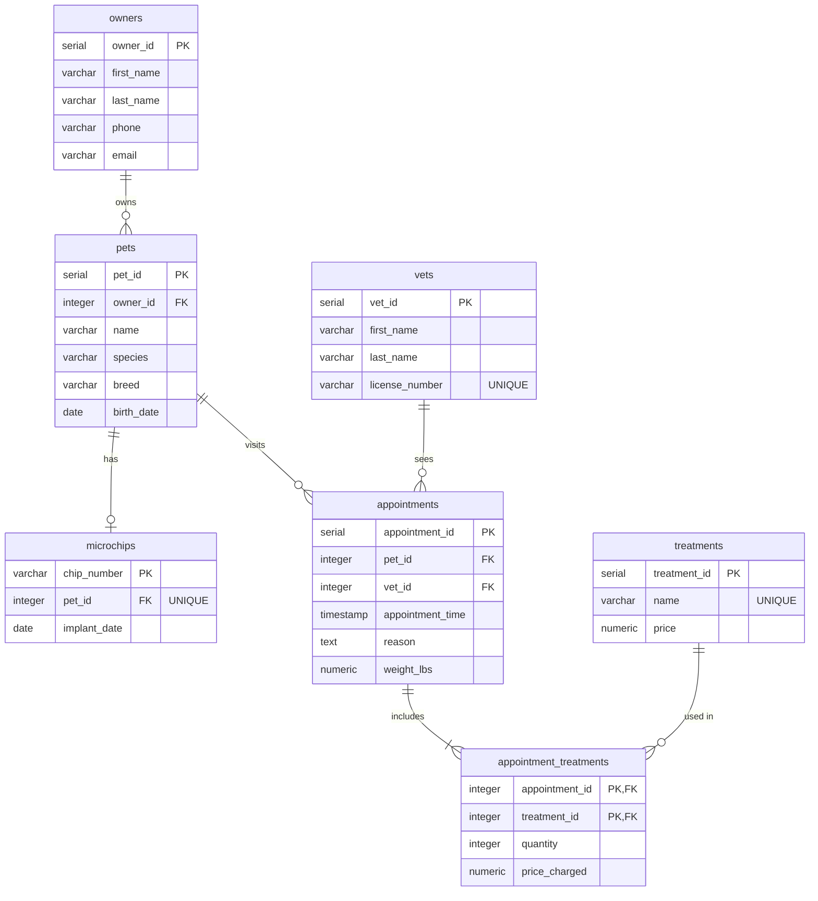

# Vet Clinic Database

An off-platform PostgreSQL project from Codecademy's Full-Stack Engineer path: design a database from scratch. The project asks you to interview a friend about a system you don't know, turn it into an Entity Relationship Diagram, then build it in PostgreSQL.

I used a small animal vet clinic as the topic. The interview in `interview_notes.md` is made up, since I didn't have someone to interview, but I followed the same process: ask questions, decide the relationships, build it, test it, and fix what broke.

There's no live site for this one. It's a set of SQL files you run against a local PostgreSQL database.

## The design

7 tables covering all 3 relationship types:

- **One to many:** one owner has many pets. One pet has many appointments. One vet has many appointments.
- **One to one:** one pet has at most one microchip (`microchips.pet_id` is UNIQUE).
- **Many to many:** one appointment can include many treatments, and one treatment shows up in many appointments. The `appointment_treatments` join table connects them.



`erd.dbml` has the same design. Paste it into [dbdiagram.io](https://dbdiagram.io) to view or edit it.

## Files

Each part of the project is its own numbered file, so the database can be rebuilt by running them in order:

- `interview_notes.md` is the research: questions, answers, and the design decision each one led to
- `erd.dbml` is the diagram for dbdiagram.io
- `01_create_tables.sql` creates the 7 tables with primary keys and foreign keys, parent tables first
- `02_insert_data.sql` adds test data: 4 owners, 6 pets, 3 chips, 3 vets, 7 treatments, 7 appointments
- `03_test_relationships.sql` runs JOIN queries that check each relationship type
- `04_edit_schema.sql` fixes the problems I found while adding data (see below)
- `05_test_constraints.sql` tries to break the rules on purpose (every statement in it should fail)

## How to run it

You need PostgreSQL installed.

Create the database:

```
psql -U postgres -c "CREATE DATABASE vet_clinic;"
```

Then run the files in order from this folder:

```
psql -U postgres -d vet_clinic -f 01_create_tables.sql
psql -U postgres -d vet_clinic -f 02_insert_data.sql
psql -U postgres -d vet_clinic -f 03_test_relationships.sql
psql -U postgres -d vet_clinic -f 04_edit_schema.sql
psql -U postgres -d vet_clinic -f 05_test_constraints.sql
```

Run each file only once. A local database keeps everything, so running the inserts twice would add every row again.

To start over, drop the database and run them all again:

```
psql -U postgres -c "DROP DATABASE vet_clinic;"
```

## Schema changes (Part 4)

Adding test data showed 3 problems with my first design:

1. **Weight was on the wrong table.** `pets.weight_lbs` could only hold one number, but weight changes at every visit. I added `weight_lbs` to `appointments`, filled it in, and dropped it from `pets`.
2. **Visit notes were too short.** `reason` was VARCHAR(100). I changed it to TEXT with `SET DATA TYPE`.
3. **Price changes would rewrite old bills.** Bills looked up the current price in `treatments`. I added `price_charged` to `appointment_treatments` so each visit saves what was actually charged. After raising the exam price from $65 to $70, old bills stayed the same.

I also added CHECK constraints so prices can't be negative and quantity has to be at least 1.

## Example output

Pets with and without a microchip (one to one, using LEFT JOIN):

```
  name  | species |   chip_number
--------+---------+-----------------
 Rocky  | dog     | 985112003456781
 Luna   | cat     |
 Peanut | rabbit  |
 Bear   | dog     | 985112003456799
 Mochi  | cat     |
 Ziggy  | dog     | 985112003456812
(6 rows)
```

Bills after the exam price went up to $70 (still using the old $65):

```
 appointment_id |  name  | total_bill
----------------+--------+------------
              1 | Rocky  |     125.00
              2 | Luna   |      95.00
              3 | Bear   |     470.00
              4 | Mochi  |      95.00
              5 | Rocky  |      65.00
              6 | Ziggy  |      47.00
              7 | Peanut |      15.00
(7 rows)
```

And the constraint tests fail the way they should:

```
ERROR:  duplicate key value violates unique constraint "microchips_pet_id_key"
ERROR:  insert or update on table "pets" violates foreign key constraint "pets_owner_id_fkey"
ERROR:  duplicate key value violates unique constraint "vets_license_number_key"
ERROR:  duplicate key value violates unique constraint "appointment_treatments_pkey"
ERROR:  new row for relation "treatments" violates check constraint "price_not_negative"
ERROR:  new row for relation "appointment_treatments" violates check constraint "quantity_at_least_one"
ERROR:  update or delete on table "owners" violates foreign key constraint "pets_owner_id_fkey" on table "pets"
```

Built by DeVante Bush
